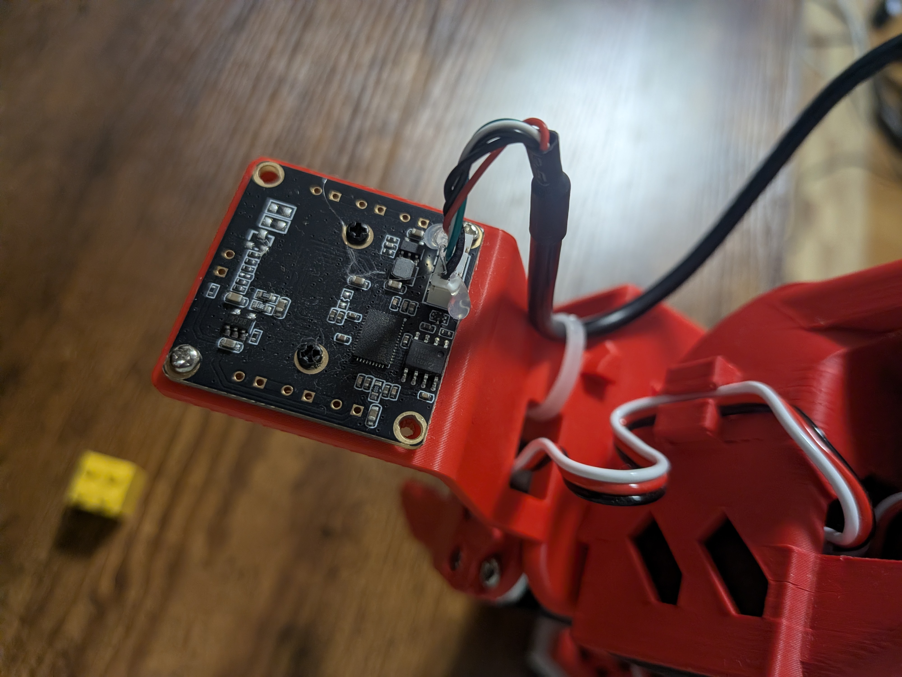

# Build Log #022 — 2026-11-08

## 今日やったこと

しばらく間が空いた。いろいろあって、関西から実家に引っ越した。SO-101 も一緒に愛媛に来たので、今日はセットアップのやり直しから始める。

一日の流れ：

1. アーム2台・カメラ・LeRobot の環境が、引っ越し前のまま使えるか確かめた
2. 手首カメラの USB が抜けていた。挿し直したら、カメラの番号が引っ越し前と入れ替わっていた
3. テレオペで動かして、運搬で関節がずれていないことを確かめた
4. #019 の宿題（SmolVLA を実機で動かし、ACT と比べる）に取りかかった

このあと「SO-101 × AWS」をテーマに進める予定（`build-log/so101aws/CLAUDE.md`）。

---

### 1. 引っ越し後の状態を確かめる

| 項目 | 状態 |
|---|---|
| アーム2台 | udev のシンボリックリンクがそのまま効いていた。`/dev/so101_follower` → `ttyACM0`、`/dev/so101_leader` → `ttyACM1` |
| 環境変数 | `FOLLOWER_ARM` / `LEADER_ARM` / `HF_HOME=/mnt/data/huggingface`（`~/.bashrc`） |
| キャリブレーション | `/mnt/data/huggingface/lerobot/calibration/` に `right_follower_arm.json` と `right_leader_arm.json` が残っていた |
| LeRobot | 0.6.2、torch 2.11.0+cu130、CUDA 使用可 |
| カメラ | 最初は C920（俯瞰）の1台だけ。**手首カメラの USB が抜けていた** |

アームのポートは、udev ルール（`/etc/udev/rules.d/99-so101.rules`）でシリアル番号から名前を付けている。だから挿す USB の口が変わっても、同じ名前で見つかる。引っ越しでも何も直さずに済んだ。

```text
SUBSYSTEM=="tty", ATTRS{serial}=="5A7A018619", SYMLINK+="so101_follower"
SUBSYSTEM=="tty", ATTRS{serial}=="5A4B047951", SYMLINK+="so101_leader"
```

### 2. カメラの番号が入れ替わっていた

手首カメラを挿し直して、もう一度カメラを探した。

```bash
cd ~/development/lerobot-workspace && source .venv/bin/activate
lerobot-find-cameras opencv
```

2台見つかった。保存された画像で、どちらがどのカメラか確かめた。

| デバイス | カメラ | 映っているもの |
|---|---|---|
| `/dev/video0` | Logitech C920 | 俯瞰（白いケース・黄色いブロック・アーム） |
| `/dev/video2` | Innomaker U20CAM | 手首（グリッパーの先） |

（`video1` / `video3` はそれぞれ同じカメラのメタデータ用のノードで、映像は出ない）

**引っ越し前とは逆になっていた。** #009 では `wrist: index 0`、`front: index 2` で動かしていた。番号は USB を挿した順で決まるので、今回は先に C920 が挿さっていた分、C920 が 0 になった。

このまま以前のコマンドで動かすと、**ポリシーに手首と俯瞰の映像を逆に渡す**ことになる。エラーは出ずに動くので、気づかないまま「掴めない」と悩むことになりかねない。

そこで、番号ではなく `/dev/v4l/by-id/` の固定パスを使うことにした。これはカメラの製品名とシリアル番号から作られるパスで、挿す順に左右されない。

```text
/dev/v4l/by-id/usb-046d_HD_Pro_Webcam_C920-video-index0                     -> ../../video0   (front)
/dev/v4l/by-id/usb-Innomaker_Innomaker-U20CAM-1080p-S1_SN0001-video-index0  -> ../../video2   (wrist)
```

LeRobot の `OpenCVCameraConfig` は `index_or_path: int | Path` なので、番号の代わりにパスを渡せる（`src/lerobot/cameras/opencv/configuration_opencv.py:61`）。

### 3. テレオペで動作確認

運搬で関節がずれていないか、リーダーアームで動かして確かめた。

```bash
cd /home/hiro/development/lerobot-workspace && source .venv/bin/activate
cd lerobot/
lerobot-teleoperate --robot.type=so101_follower --robot.port=$FOLLOWER_ARM --robot.id=right_follower_arm \
  --teleop.type=so101_leader --teleop.port=$LEADER_ARM --teleop.id=right_leader_arm
```

```text
INFO 2026-11-08 17:57:25 so_leader.py:78 right_leader_arm SOLeader connected.
INFO 2026-11-08 17:57:25 follower.py:109 right_follower_arm SOFollower connected.
Teleop loop time: 16.73ms (60 Hz)
^CINFO 2026-11-08 17:58:00 le_timer.py:606 Cadence summary — whole run · target 60 Hz (16.7 ms budget per tick): 2110 ticks, 2109 judged
  effective cadence: 59.66 Hz over 35.4 s measured
  ticks over the 16.7 ms work budget: 0/2109 (0.0%) — work mean 2.7 ms, worst 5.5 ms
  loop-body steps (share of measured work):
    observe  mean   0.97 ms · worst  51.75 ms ·  35.3% of work · 2111 calls
    teleop   mean   1.68 ms · worst   2.79 ms ·  61.1% of work · 2111 calls
    send     mean   0.08 ms · worst   2.95 ms ·   3.1% of work · 2110 calls
  pacing headroom: 14.0 ms slept per tick on average (max 14.5 ms) — near zero means the loop is saturated
INFO 2026-11-08 17:58:00 o_leader.py:163 right_leader_arm SOLeader disconnected.
```

- **リーダーに合わせてフォロワーが動いた。** キャリブレーションはやり直さなくてよかった
- 約35秒動かして、平均 **59.66Hz**（目標 60Hz）。16.7ms の枠を超えた周期は 0/2109
- 1周期の処理は平均 2.7ms、最大 5.5ms。残りの約 14ms は待ち時間
- `observe`（フォロワーの関節角の読み取り）の最大が 51.75ms だった。1回だけの引っかかりで、全体の周期には影響していない（超過 0 件）。原因は調べていない
- この Cadence summary は、引っ越し前の LeRobot では見た覚えがない。いつから出るようになったかは確かめていない

### 4. #019 の宿題：SmolVLA を実機で動かす

#019 で学習した `emboss369/smolvla-yellow-lego-to-white-case` を、引っ越し後の実機で動かす。ここにたどり着くまでに2回失敗した。

#### 4-1. 1回目：Hub からのダウンロードが終わらない

最初は Hub のモデルを指定して実行した。

```bash
cd /home/hiro/development/lerobot-workspace && source .venv/bin/activate
cd lerobot/
lerobot-rollout \
  --robot.type=so101_follower --robot.port=$FOLLOWER_ARM --robot.id=right_follower_arm \
  --robot.cameras='{
    wrist: {type: opencv, index_or_path: /dev/v4l/by-id/usb-Innomaker_Innomaker-U20CAM-1080p-S1_SN0001-video-index0, width: 640, height: 480, fps: 30},
    front: {type: opencv, index_or_path: /dev/v4l/by-id/usb-046d_HD_Pro_Webcam_C920-video-index0, width: 640, height: 480, fps: 30}
  }' \
  --policy.path=emboss369/smolvla-yellow-lego-to-white-case \
  --fps=30 --task="Put the yellow lego block into the white case" \
  --display_data=false --duration=0 \
  2>&1 | tee /mnt/data/lerobot-outputs/logs/rollout_smolvla_022.log
```

`Loading weights: 100%` のあと、6分以上何も出なくなった。GPU のメモリは 18MiB で、まだ何も載っていなかった。

プロセスを調べると、Hugging Face への HTTPS 接続が10本開いていて、ポリシー本体（`model.safetensors`、約1.3GB）をダウンロードしている途中だった。Xet（Hugging Face の転送方式）のログには、転送の失敗が続いて並列数が1まで下がった様子が残っていた。

```text
Concurrency control for download: Decreased concurrency from 1 to 1; reason: transfer failed ...
Current concurrency = 1; predicted bandwidth = 205190; ... observed bytes sent so far = 214743418
```

推定帯域は約 200KB/s で、約 15 分かけて約 215MB。最後はエラーで落ちた。

```text
RuntimeError: Task error: File reconstruction error: CAS Client Error: Format error: I/O error: error decoding response body
```

このとき fast.com で回線を測った（Matsuyama → BIGLOBE、サーバーは大阪）。

| 項目 | 値 |
|---|---|
| ダウンロード | 13 Mbps |
| アップロード | 110 Mbps |
| レイテンシ（負荷なし） | 12 ms |
| レイテンシ（負荷あり） | **1.2 s** |

測ったのは1回だけなので、時間帯による混雑かどうかはまだ分からない。ただ、負荷がかかるとレイテンシが 1.2 秒まで伸びるのは、このあとの AWS 編（クラウドからエッジへ指令を送る遅延を測る）に効いてくるかもしれない。

**対処**：#019 の学習で作ったチェックポイントが手元に残っていた。`checkpoints/last` は `020000` を指していて、Hub に上げたのと同じ最終ステップ。ダウンロードせずにこれを使う。

#### 4-2. 2回目：カメラ名が合わない

```text
ValueError: Visual feature mismatch between policy and robot hardware.
Policy expects: {'observation.images.camera1', 'observation.images.camera2', 'observation.images.camera3'}
Robot provides: {'observation.images.wrist', 'observation.images.front'}
Use --rename_map to map camera names, e.g. --rename_map='{"observation.images.top": "observation.images.cam0"}'
```

#019 では「読み替えはチェックポイントに保存されているので、推論のときもカメラ名 `wrist` / `front` のままで使える見込み」と書いていた。**この見込みは外れた。**

`src/lerobot/rollout/context.py` を読むと：

- カメラ名のチェック（417〜436行）は、**コマンドラインで `--rename_map` を渡さなかったときだけ**行われる
- 508行目で、プリプロセッサの読み替えを `cfg.rename_map`（コマンドラインの値）で上書きしている

つまり、チェックポイントに読み替えが保存されていても、推論のときには**学習と同じ `--rename_map` をもう一度渡す**必要がある。`camera3` が無いことは問題にならない（#019 で確かめたとおり、`empty_cameras=0` なので入力から外れるだけ）。

#### 4-3. 3回目：動いた

```bash
cd /home/hiro/development/lerobot-workspace && source .venv/bin/activate
cd lerobot/
lerobot-rollout \
  --robot.type=so101_follower --robot.port=$FOLLOWER_ARM --robot.id=right_follower_arm \
  --robot.cameras='{
    wrist: {type: opencv, index_or_path: /dev/v4l/by-id/usb-Innomaker_Innomaker-U20CAM-1080p-S1_SN0001-video-index0, width: 640, height: 480, fps: 30},
    front: {type: opencv, index_or_path: /dev/v4l/by-id/usb-046d_HD_Pro_Webcam_C920-video-index0, width: 640, height: 480, fps: 30}
  }' \
  --policy.path=/mnt/data/lerobot-outputs/train/smolvla_yellow_lego/checkpoints/last/pretrained_model \
  --rename_map='{"observation.images.front":"observation.images.camera1","observation.images.wrist":"observation.images.camera2"}' \
  --fps=30 --task="Put the yellow lego block into the white case" \
  --display_data=false --duration=0 \
  2>&1 | tee /mnt/data/lerobot-outputs/logs/rollout_smolvla_022.log
```

- タスク文は学習データ（#019）と一字一句同じにした。SmolVLA は言語で条件付けされるので、文が変わると動きが変わる可能性がある
- `front → camera1`、`wrist → camera2` も学習と同じ対応。逆にしてもエラーは出ないので、間違えると気づけない

**結果：何度もやり直しながら、なんとか掴む。** それでも悪くない、というのが見た印象。（成功回数は数えていない）

#### 4-4. 推論の速さ：1.67 秒ごとに約 0.1 秒の引っかかり

ログには遅延の警告が並んでいた。

```bash
grep -c 'running slower' /mnt/data/lerobot-outputs/logs/rollout_smolvla_022.log   # → 128
grep -c 'read failed'    /mnt/data/lerobot-outputs/logs/rollout_smolvla_022.log   # → 0
```

```text
WARNING 2026-11-08 18:19:51 le_timer.py:407 Control loop is running slower (9.7 Hz) than the target FPS (30 Hz). ...
WARNING 2026-11-08 18:19:53 le_timer.py:407 Control loop is running slower (9.7 Hz) than the target FPS (30 Hz). ...
WARNING 2026-11-08 18:19:55 le_timer.py:407 Control loop is running slower (9.8 Hz) than the target FPS (30 Hz). ...
```

一見「ずっと 9.7Hz でしか回っていない」ように読めるが、そうではないと考えている。

- 警告は**遅かった周期ごとに1回**出る実装（`src/lerobot/utils/cycle_timer.py` 383〜410行。最初の1周期は起動コストとして除外）
- 警告の間隔は約 1.7 秒。実行時間は 18:19:49〜18:23:32 の約 223 秒で、警告は 128 回
- SmolVLA は1回の推論で 50 ステップ分の動作を出す（`config.json` の `n_action_steps: 50`）。30Hz なら推論は 50 ÷ 30 = **1.67 秒に1回**。223 ÷ 1.67 ≈ 134 回で、警告の回数とほぼ合う

つまり、**推論する周期だけが約 103ms（1/9.7Hz）かかって 33ms の枠をはみ出し、残りの 49 周期は 30Hz に間に合っている**、と読める。アームの動きでいうと、1.67 秒ごとに約 0.1 秒止まることになる。

- #009 で ACT を回したときは、警告は起動時の1回だけだった。ACT の推論は 33ms に収まっていた
- この引っかかりが「何度もやり直す」動きと関係しているかは分からない。調べていない
- 推論の時間（約 103ms）は警告の Hz からの逆算で、直接は測っていない

カメラの読み取り失敗（`read failed`）は 0 回だった。#009 で起きた手首カメラの脱落は、今回は出ていない。

### 5. ACT（day3）のダウンロードと、回線が遅かった原因

#### 5-1. ACT day3 も落ちてこない

比べる相手の `emboss369/act-yellow-lego-to-white-case-day3` は、ローカルにはキャッシュも学習出力も残っていなかった。Hub から落とすしかない。本体の `model.safetensors` は 206,699,736 バイト（約 207MB）。

| 方法 | 結果 |
|---|---|
| `HF_HUB_DISABLE_XET=1 hf download ...`（Xet を切って HTTP で） | 252 秒で `httpx.ReadTimeout`。本体は 0 バイト |
| `curl -L` で直接 | 40 秒で 419,876 バイト（約 10 KB/s）。リダイレクト先は `us.aws.cdn.hf.co` |

10 KB/s だと 207MB に5時間以上かかる。そこで、遅くなったら打ち切って続きから再開する curl をループで回した。

```bash
mkdir -p /mnt/data/lerobot-outputs/policies/act-day3 && cd /mnt/data/lerobot-outputs/policies/act-day3
# 設定ファイル類は hf download で取れていたので、キャッシュからコピー
cp -L /mnt/data/huggingface/hub/models--emboss369--act-yellow-lego-to-white-case-day3/snapshots/*/* .
until curl -sL -C - --max-time 600 --speed-limit 1000 --speed-time 60 -o model.safetensors \
    https://huggingface.co/emboss369/act-yellow-lego-to-white-case-day3/resolve/main/model.safetensors \
  && [ "$(stat -c%s model.safetensors)" = 206699736 ]; do
  echo "$(date +%T) $(stat -c%s model.safetensors) bytes, retry"; sleep 5
done
sha256sum model.safetensors   # Hub の LFS のハッシュ 0a2fdac7... と一致
```

- `-C -`：途中まで落としたファイルの続きから再開する
- `--speed-limit 1000 --speed-time 60`：60 秒間 1000 B/s を下回ったら打ち切る

```text
18:35:10 2958331 bytes, retry
done in 70s
```

1本目の接続は約 3MB で詰まって打ち切られ、**つなぎ直した2本目で残りの約 204MB が1分弱で届いた**。帯域が足りないのではなく、**特定の接続が詰まる**という症状だった。

#### 5-2. 原因：Wi-Fi の IPv6（省電力ではなかった）

最初は Wi-Fi の省電力を疑って切った。

```bash
# すぐに効かせる（再接続すると戻る）
sudo iwconfig wlp5s0 power off

# 再起動後も切ったままにする
sudo nano /etc/NetworkManager/conf.d/default-wifi-powersave-on.conf
#   wifi.powersave = 3   （有効）
#   → wifi.powersave = 2 （無効）
```

**でも、これでは直らなかった。** Wi-Fi の接続の **IPv6 を無効にしたら、すぐに解決した。**

```text
$ nmcli -g ipv6.method connection show AirPort
disabled
$ sysctl net.ipv6.conf.wlp5s0.disable_ipv6
net.ipv6.conf.wlp5s0.disable_ipv6 = 1
```

fast.com（Matsuyama → BIGLOBE、サーバーは大阪）の結果：

| 項目 | 直す前（18:10 ごろ） | 直したあと |
|---|---|---|
| ダウンロード | 13 Mbps | **43 Mbps** |
| アップロード | 110 Mbps | 140 Mbps |
| レイテンシ（負荷なし） | 12 ms | 12 ms |
| レイテンシ（負荷あり） | 1.2 s | **100 ms** |

- どちらも1回ずつしか測っていない
- 省電力は切ったまま（`Power Management:off`）にしてある。省電力を戻して IPv6 だけを切った状態では測っていない
- なぜ IPv6 で遅くなるのかは調べていない。節5-1の「特定の接続だけが詰まり、つなぎ直すと速い」という症状は、「IPv6 で張った接続は詰まり、IPv4 で張った接続は速い」と考えると辻褄が合う。ただし確かめてはいない（推測）。プロバイダは BIGLOBE、ルーターの IPv6 の設定も見ていない
- 2.4GHz 帯につながっている

これは AWS 編にも効いてくる。クラウドからエッジへの指令は、エッジから見ると「受信」。直す前の状態で配送遅延（E1）を測っていたら、通信の不調がそのまま測定値に入っていたはず。**測る前に気づけてよかった。** E1 の測定条件として、「エッジは Wi-Fi・2.4GHz・IPv6 無効（IPv4 で接続）」と記録しておく。

### 6. ACT（day3）と比べる

#### 6-1. 1回目：13秒で手首カメラが落ちた

```bash
cd /home/hiro/development/lerobot-workspace && source .venv/bin/activate
cd lerobot/
lerobot-rollout \
  --robot.type=so101_follower --robot.port=$FOLLOWER_ARM --robot.id=right_follower_arm \
  --robot.cameras='{
    wrist: {type: opencv, index_or_path: /dev/v4l/by-id/usb-Innomaker_Innomaker-U20CAM-1080p-S1_SN0001-video-index0, width: 640, height: 480, fps: 30},
    front: {type: opencv, index_or_path: /dev/v4l/by-id/usb-046d_HD_Pro_Webcam_C920-video-index0, width: 640, height: 480, fps: 30}
  }' \
  --policy.path=/mnt/data/lerobot-outputs/policies/act-day3 \
  --fps=30 --task="Put the yellow lego block into the white case" \
  --display_data=false --duration=0 \
  2>&1 | tee /mnt/data/lerobot-outputs/logs/rollout_act_day3_022.log
```

`--rename_map` は付けない。ACT はカメラ名 `wrist` / `front` のまま学習している。`--task` は ACT では使われない（SmolVLA とコマンドをそろえるために残した）。

動き出して13秒で、手首カメラの読み取りが続けて失敗して止まった。

```text
WARNING 2026-11-08 18:38:08 a_opencv.py:487 Error reading frame in background thread for OpenCVCamera(/dev/v4l/by-id/usb-Innomaker_...): ... read failed (status=False).
（同じ警告が11回）
RuntimeError: OpenCVCamera(/dev/v4l/by-id/usb-Innomaker_...) exceeded maximum consecutive read failures.
WARNING 2026-11-08 18:38:08 ies/core.py:194 Could not return to initial position: OpenCVCamera(...) read thread is not running.
[ WARN:0@17.961] global cap_v4l.cpp:804 requestBuffers VIDEOIO(V4L2:/dev/v4l/by-id/usb-Innomaker_...): failed VIDIOC_REQBUFS: errno=19 (No such device)
```

`errno=19 (No such device)` は #009 節15 と同じで、手首カメラが USB から消えている。

止まるまでの13秒間の数字は取れた。

```text
Cadence summary — whole run · target 30 Hz (33.3 ms budget per tick): 387 ticks, 386 judged
  effective cadence: 29.52 Hz over 13.1 s measured
  ticks over the 33.3 ms work budget: 0/386 (0.0%) — work mean 1.9 ms, worst 11.3 ms
    observe      mean   0.99 ms · worst   2.48 ms
    infer        mean   1.35 ms · worst 212.89 ms
    send         mean   0.10 ms · worst   0.20 ms
```

| | ACT day3 | SmolVLA（節4-4） |
|---|---|---|
| 実効の周期 | 29.52 Hz | 約 30 Hz（ただしチャンクの切り替えごとに 9.7 Hz の周期が1回） |
| 遅延の警告 | 0 回 | 128 回 |
| 1回のチャンク | 100 ステップ（3.3 秒） | 50 ステップ（1.67 秒） |
| 推論 | 平均 1.35 ms、最大 212.89 ms | 約 103 ms（警告からの逆算） |

ACT の `infer` の最大 212.89 ms が枠（33.3 ms）を超えているのに警告が 0 回なのは、最初の1周期を起動コストとして判定から外す実装だから（節4-4。`386 judged` で 387 のうち1つ除外）。

#### 6-2. 手首カメラは、アームが動くと切れていた

カーネルのログで、手首カメラ（`usb 3-2`、`idVendor=0c45`）の接続と切断を追った。

```bash
journalctl -k --since "17:00" --no-pager | grep -iE "usb 3-.*(disconnect|new .*device)"
```

| 時刻 | できごと | そのとき |
|---|---|---|
| 17:27:55 | 接続 | PC の起動 |
| **17:30:40** | **切断** | 不明。17:46 に確かめたとき「抜けている」と思った |
| 17:47:01 | 接続 | 挿し直した |
| **17:57:38** | **切断 → 1秒後に再接続** | **テレオペでアームを動かしていた最中**（17:57:24〜17:58:00） |
| **18:38:08** | **切断** | **ACT でアームが動き出して13秒後** |

- テレオペではカメラを使っていないので、切れても気づかなかった
- 節1の「USB が抜けていた」も、実際は**挿さったまま 17:30 に切れていた**のかもしれない
- アームが動くと切れる。手で確かめると、**カメラ基板側のコネクタが緩く、動かすと途切れることが多かった**
- #009（8月）でも1回落ちている。もともと緩かったものが、引っ越しの運搬で悪化したのかもしれない（推測）

#### 6-3. コネクタをグルーガンで固め、ケーブルを結束バンドで留めた



- カメラ基板の4ピンのコネクタを、グルーガンで基板ごと固めた
- ケーブルは手首のブラケットに結束バンドで留めた。コネクタの手前には輪のたるみを残し、アームの動きで引っ張られる力がコネクタに直接かからないようにした

挿し直したのは 19:31:53。そのあと Day3 と Day1 を続けて回したが、カーネルのログに `USB disconnect` は出ず、`read failed` も 0 回だった。補強は効いている（ただし今日の数回ぶんだけの確認）。

```bash
journalctl -k --since "19:00" --no-pager | grep -E "usb 3-"
# 19:31:53 の接続のあと、切断なし
```

#### 6-4. Day3、Day1 も試した結果

| ポリシー | 学習データ | 見た印象 |
|---|---|---|
| **SmolVLA**（#019） | Day1〜3、150 エピソード | 何度もやり直しながら、なんとか掴む。**3つの中で一番掴めた** |
| ACT day3（#009） | Day1〜3、150 エピソード | いまいち |
| ACT day1（#005） | Day1、50 エピソード | いまいち |

- 成功回数は数えていない。印象での比較
- ACT day1 は #006 で「データを取った位置の近くなら安定して掴めた」ポリシー。今回いまいちだったのは、引っ越しで机と俯瞰カメラの位置が変わり、学習時と画面の中の配置がずれたせいかもしれない（推測。確かめていない）
- 同じデータ（150 エピソード）で比べると、ACT より SmolVLA のほうが掴めた。#019 の宿題への答えは、これで1つ出た

**このあとの AWS 編では、SmolVLA を使う。**

### 7. SO-101 × AWS：段階0（準備）

ここからは「SO-101 × AWS」（計画書は `build-log/so101aws/CLAUDE.md`）。使うポリシーは節6-4の結果から SmolVLA に決め、計画書の ACT をすべて SmolVLA に書き換えた。

#### 7-1. 決めたこと

| 項目 | 決定 |
|---|---|
| コードの置き場所 | 別リポジトリにせず、このリポジトリの `build-log/so101aws/` |
| AWS CLI の認証 | この作業専用の IAM ユーザー `so101-aws-work` のアクセスキー。**作業が終わったらキーを無効化する** |
| 予算のアラート | 月 20 USD |
| 証明書の方式 | 鍵と CSR を手元で作り、CSR だけを Terraform に渡す |

このリポジトリは公開しているので、コードより先に `build-log/so101aws/.gitignore` を置いた。証明書・秘密鍵（`certs/`、`*.pem` など）、Terraform の state、`*.tfvars`、エッジの実設定が Git に入らないようにしている。

#### 7-2. Terraform と AWS CLI を入れる

前回（lerobot-aws-infra）は Mac だった。Ubuntu では公式の手順で入れた。

```bash
# Terraform（HashiCorp 公式の apt リポジトリ。https://developer.hashicorp.com/terraform/install）
wget -O - https://apt.releases.hashicorp.com/gpg | sudo gpg --dearmor -o /usr/share/keyrings/hashicorp-archive-keyring.gpg
echo "deb [arch=$(dpkg --print-architecture) signed-by=/usr/share/keyrings/hashicorp-archive-keyring.gpg] https://apt.releases.hashicorp.com $(grep -oP '(?<=UBUNTU_CODENAME=).*' /etc/os-release || lsb_release -cs) main" | sudo tee /etc/apt/sources.list.d/hashicorp.list
sudo apt update && sudo apt install terraform

# AWS CLI v2（公式の zip。https://docs.aws.amazon.com/cli/latest/userguide/getting-started-install.html）
cd /tmp && curl "https://awscli.amazonaws.com/awscli-exe-linux-x86_64.zip" -o "awscliv2.zip"
unzip awscliv2.zip
sudo ./aws/install
```

```text
$ terraform -version
Terraform v1.17.1
$ aws --version
aws-cli/2.39.6 Python/3.14.8 Linux/7.0.0-42-generic script-exe/x86_64.ubuntu.24
```

`aws configure` でアクセスキーを入れた（キーは自分のターミナルでだけ扱う）。今の AWS CLI は `aws configure` の最後に「AI コーディングエージェント用の AWS スキルと AWS MCP サーバーを設定するか」と聞いてくる。y にしたら、Claude Code に AWS のスキルが 25 個入り、`~/.claude.json` に AWS MCP サーバーが登録された。

```bash
aws sts get-caller-identity
# "Arn": "arn:aws:iam::<アカウントID>:user/so101-aws-work"
```

#### 7-3. Budgets のアラートを Terraform で作る

`build-log/so101aws/infra/` に `versions.tf`（aws provider `~> 6.72`、全リソースに `project = physical-ai-so101` のタグ）、`variables.tf`、`budgets.tf`、`outputs.tf` を置いた。

```hcl
resource "aws_budgets_budget" "monthly" {
  name         = "physical-ai-so101-monthly"
  budget_type  = "COST"
  limit_amount = tostring(var.budget_usd)   # 20
  limit_unit   = "USD"
  time_unit    = "MONTHLY"

  notification {   # 実績が 80% を超えたら
    comparison_operator        = "GREATER_THAN"
    threshold                  = 80
    threshold_type             = "PERCENTAGE"
    notification_type          = "ACTUAL"
    subscriber_email_addresses = [var.alert_email]
  }

  notification {   # 月末の予測が 100% を超えそうなら
    comparison_operator        = "GREATER_THAN"
    threshold                  = 100
    threshold_type             = "PERCENTAGE"
    notification_type          = "FORECASTED"
    subscriber_email_addresses = [var.alert_email]
  }
}
```

メールアドレスは `terraform.tfvars`（Git 管理外）に書いた。

```bash
cd build-log/so101aws/infra
terraform fmt && terraform init && terraform validate
terraform plan -out=budgets.tfplan     # 1 to add, 0 to change, 0 to destroy
terraform apply budgets.tfplan         # plan を見て承認してから
```

```text
aws_budgets_budget.monthly: Creation complete after 9s [id=<アカウントID>:physical-ai-so101-monthly]
Apply complete! Resources: 1 added, 0 changed, 0 destroyed.
```

**確認メールは来なかった。** AWS のドキュメント（Budgets の email recipients のページ）には「通知先にアドレスを足すと確認メールが届き、確認したアドレスにだけ通知が届く」とある。ただしこれはコンソールの説明で、API や Terraform で作ったときのことは書かれていない。確認状態は API では見えず、コンソールの予算の詳細画面にしか出ない。

コンソールで見ると、状態は **Active (legacy)** だった。確認の仕組みができる前から使っていたアドレスにつく状態で、確認しなくても通知は届く。このアカウントで以前の予算に同じアドレスを使っていたためだと思う（推測）。

- 新しいアドレスを Terraform で通知先にした場合に、確認メールが自動で来るのかは、今回は分からなかった
- 状態が Inactive なら、コンソールの「Send Notification」で確認メールを送る必要がある（ドキュメントより）

#### 7-4. 段階1〜2のための確認

計画書の【要確認】のうち、段階1〜2で使うものを公式ドキュメントで確かめた。結果は計画書の §5 に書いた。大事なものは次のとおり。

- `aws_iot_certificate` に `csr` を渡すと、`private_key` は出力されない（「CSR も証明書も渡さないとき」だけ出る）。つまり CSR 方式なら、秘密鍵は Terraform の state に入らない。これで証明書の方式を決めた
- IoT ルールの `topic(2)` で、`so101/<thing>/result` のモノ名が取れる。S3 アクションの `key` には置換テンプレートが使える
- IoT Core の料金ページに東京の単価は載っていなかった

エッジ PC の時刻同期も見た。

```text
$ timedatectl
System clock synchronized: yes
              NTP service: active
$ timedatectl timesync-status
       Server: 185.125.190.56 (ntp.ubuntu.com)
       Offset: -33.463ms
        Delay: 233.104ms
```

同期はしているが、NTP サーバーが遠く（往復 233 ms）、時計のずれが -33 ms ある。E1 では「クラウドで送った時刻」と「エッジで受けた時刻」の差を測るので、このずれがそのまま測定値に混ざる。E1 の前に、近い NTP サーバーに切り替える。

### 8. SO-101 × AWS：段階1（エッジ、実機なし）

AWS にも実機にもつながずに、エッジ側の「指令を受けて、判断して、動かして、結果を返す」部分を作った。置き場所は `build-log/so101aws/edge/`。

| ファイル | 中身 |
|---|---|
| `protocol.py` | メッセージの仕様。指令の検証（`parse_command`）、result と status の組み立て、トピック名 |
| `runner.py` | ポリシーを動かす部分の差し替え口。今は `FakeRunner`（指定秒だけ「実行中」のふりをする）だけ |
| `edge_agent.py` | 本体。指令の処理順、状態の管理（IDLE / RUNNING / STOPPING）、重複排除、時間切れ、停止キー、定期的な status |
| `tests/test_edge_agent.py` | 単体テスト 45 件 |

MQTT の送信は関数として外から渡す形にした。段階1では画面に出すだけ（`LocalTransport`）で、段階2で AWS IoT の MQTT5 クライアントに差し替える。

#### 8-1. 指令の処理順

計画書 §4.4 の順番をそのままコードにした。上から評価し、最初に当てはまったもので終わる。

1. 形が不正・バージョン違い → `rejected/invalid`
2. 見たことのある `cmd_id` → 動かさない。終わっていれば前回の結果を送り直し、実行中なら何もしない
3. 停止の指令 → 実行中なら止める（`aborted/cloud_stop`）、何もしていなければ無視
4. 期限切れ（受け取った時刻 − 送った時刻 > `ttl_s`）→ `rejected/expired`
5. 許可リストにないタスク → `rejected/unknown_task`
6. 実行中・停止中 → `rejected/busy`
7. 実行を始める

順番に意味があるので、そこもテストした。

- 2 が 4 より先：終わった指令が1時間遅れで再送されても、「期限切れ」ではなく前回の結果を返す
- 3 が 4 より先：古い停止の指令でも止める（止める側は安全側に倒す）
- 5 が 6 より先：実行中に許可リストにないタスクが来たら、「busy」ではなく「unknown_task」

クラウドが `max_run_s` を長く指定しても、エッジの上限（`EDGE_MAX_RUN_S`、今は 120 秒）で切り詰める。これもテストで確かめた（上限 0.1 秒にして、3600 秒を頼んでも時間切れで止まる）。

計画書にない場合が1つあった。Runner が 0 以外の終了コードで終わったときの扱いが、状態遷移の表になかった。`aborted/runner_error` を足して、計画書にも書いた。

#### 8-2. テスト

```bash
cd build-log/so101aws/edge
uv run --no-project --python 3.12 --with pytest pytest -q tests
```

```text
45 passed in 1.28s
```

スレッドを使っているので、たまたま通っただけでないか、20回くり返した。20回とも 45 件すべて通った。

#### 8-3. 手で動かす

```bash
cd build-log/so101aws/edge
python3 edge_agent.py --demo-run --fake-duration 30 --heartbeat-s 1
# 起動直後に run_task を1件流し込む。s + Enter で止める
```

```text
PUB so101/so101-edge-01/status (retain) {"v": 1, "state": "IDLE", "cmd_id": null, ...}
PUB so101/so101-edge-01/status (retain) {"v": 1, "state": "RUNNING", "cmd_id": "8f3339df-...", ...}
PUB so101/so101-edge-01/status (retain) {"v": 1, "state": "STOPPING", "cmd_id": "8f3339df-...", ...}
[edge] 停止を要求しました
PUB so101/so101-edge-01/result {"v": 1, "cmd_id": "8f3339df-...", "state": "aborted", "reason": "operator_stop", ...}
PUB so101/so101-edge-01/status (retain) {"v": 1, "state": "IDLE", "cmd_id": null, ...}
```

`s` を押してから result が出るまで約 36 ms（STOPPING の 24.203 → result の 24.239）。FakeRunner は止めるのが一瞬なので、本物の `lerobot-rollout` ではもっとかかるはず。

#### 8-4. 実機の前に、ソースで止まり方を予測する

段階1の後半は実機で確かめる。その前に、`lerobot-rollout` のソースで「どう終わるか」を読んだ。

- `--duration` の時間になると、制御ループを抜ける（`src/lerobot/rollout/strategies/base.py` 64〜66行）
- SIGINT・SIGTERM などは1回目は「終了の合図」を立てるだけ（`src/lerobot/utils/process.py`）。2回目で `sys.exit(1)` の強制終了
- どちらの場合も後始末（`strategies/core.py` の `_teardown_hardware`）で、**開始時の姿勢に 3 秒かけて戻り**（`return_to_initial_position`、既定で有効）、切断する
- 切断のとき `disable_torque_on_disconnect=True`（既定）なので、**トルクが切れて脱力する**

つまり、どう終わっても最後は開始時の姿勢で脱力する。**開始時の姿勢を「脱力しても安全な姿勢」（机に畳んだ休止の姿勢）にしておけば安全**、という予測になる。

実行用と緊急停止用のスクリプトを作った（`build-log/so101aws/scripts/`）。

- `rollout_smolvla.sh`：節4-3のコマンドをスクリプトにした。`DURATION` 秒で終わる。動かす前に、別の LeRobot プロセスが動いていないか、アームとカメラが見えるかを確かめる
- `emergency_stop.sh`：SIGINT → 待つ → SIGTERM → 待つ → SIGKILL の順に送る

#### 8-5. 実機で確かめる

**試験A：20秒で自然に終わる**

```bash
cd build-log/so101aws/scripts
DURATION=20 ./rollout_smolvla.sh; echo "exit=$?"
```

**試験B：動いている途中で緊急停止**

```bash
# ターミナル1
DURATION=120 ./rollout_smolvla.sh; echo "exit=$?"
# ターミナル2（アームが動き出してから）
./emergency_stop.sh
```

```text
21:56:56.828 SIGINT → 18337
21:57:02.440 停止した（SIGINT）
```

| | 試験A | 試験B |
|---|---|---|
| 起動（スクリプト開始 → 制御ループ開始） | 約 15 秒 | 約 15 秒 |
| 終わるきっかけ | `Duration limit reached (20s)` | `Shutdown signal 2 received` |
| 開始時の姿勢に戻る | 3 秒 | 3 秒 |
| 切断（カメラ2台・アーム） | 約 2 秒 | 約 2 秒 |
| きっかけ → プロセス終了 | 約 5 秒 | **5.6 秒** |
| 最後 | 開始時の姿勢で脱力、`exit=0` | 開始時の姿勢で脱力。SIGINT 1回で止まった |

予測どおりだった。これで計画書の `stop_behavior` が決まった。

- 停止の待ち時間：実測 5.6 秒なので、SIGINT のあと **10 秒** 待ってから SIGTERM に上げる
- `max_run_s`：起動に 15 秒、後始末に 6 秒かかるので、「動かす秒数 + 21 秒 + 余裕」にする

遅延の警告は、20 秒で 11 回、10 秒で 5 回。1.67 秒に 1 回で、節4-4 の「チャンクの切り替えのたびに1回だけ遅い」という読みと合う。

1つ直した。スクリプトはログを `tee` に流している。Ctrl+C のようにプロセスグループ全体に SIGINT が届くと、`tee` が先に止まり、`lerobot-rollout` が後始末のログを書けなくなるおそれがある。`tee` は INT/TERM を無視するようにし、edge_agent からの SIGINT は `lerobot-rollout` 本体にだけ送るようにした。

これを元に `PolicyRunner` を作った（`edge/runner.py`）。スクリプトを別のプロセスグループで起動し、止めるときは SIGINT → 10 秒 → SIGTERM → 10 秒 → SIGKILL。実機の代わりに「lerobot-rollout のふりをするプロセス」（`tests/fake_rollout.py`）を使って、3通りの止まり方（SIGINT で止まる／SIGTERM まで要る／SIGKILL まで要る）をテストした。

**試験C：edge_agent から実機を動かす**

```bash
cd build-log/so101aws/edge
# C1：20秒で自然に終わる。終わったら成否を y/n で入力
python3 edge_agent.py --runner policy --run-s 20 --demo-run --label
# C2：動いている途中で s + Enter
python3 edge_agent.py --runner policy --run-s 60 --demo-run
```

C1 の result（ブロックは掴めなかったので `n`）：

```text
PUB so101/so101-edge-01/result {"v": 1, "cmd_id": "62ecb207-...", "state": "completed", "reason": "ok", ..., "finished_at": "2026-11-08T13:02:47.694Z", "operator_label": "fail"}
```

C2（`s` を押したところから）：

```text
s
PUB so101/so101-edge-01/status (retain) {"v": 1, "state": "STOPPING", ..., "ts": "2026-11-08T13:04:45.251Z"}
[edge] 停止を要求しました
INFO 2026-11-08 22:04:45 s/process.py:89  Shutdown signal 2 received. Cleaning up…
INFO 2026-11-08 22:04:45 ies/core.py:159 Returning robot to initial position before shutdown...
...
INFO 2026-11-08 22:04:50 _rollout.py:267 Rollout finished
PUB so101/so101-edge-01/result {"v": 1, "cmd_id": "ae1671b4-...", "state": "aborted", "reason": "operator_stop", ..., "finished_at": "2026-11-08T13:04:50.721Z", "operator_label": "none"}
PUB so101/so101-edge-01/status (retain) {"v": 1, "state": "IDLE", "cmd_id": null, ...}
```

- C1：`completed/ok`、ラベル `fail`。開始時の姿勢に戻って脱力した
- C2：`s` から result まで 5.5 秒（STOPPING 45.251 → result 50.721）。試験B の 5.6 秒とほぼ同じ

#### 8-6. 試験Cで見つかった2つの問題

**全角の「ｓ」で止まらなかった。** C2 では、最初に 22:04:31 ごろ `ｓ` を打っていた。日本語入力がオンのままで全角になっていて、停止として扱われなかった。半角の `s` を打ち直した 22:04:45 にやっと止まった。**止めたいときに止まらなかった**ので、安全に関わる。入力を NFKC で正規化して、全角の `ｓ`・`ｙ`・`ｎ` も受け付けるようにした。

**`finished_at` に、y/n を入力するまでの時間が入っていた。** C1 でアームが止まったのは 22:02:40 なのに、`finished_at` は 13:02:47.694（UTC。日本時間 22:02:47）だった。成否を入力した時刻になっていた。ポリシーの実行が終わった時点で記録するように直した。

どちらもテストを足した（全部で 56 件。5回くり返して5回とも通った）。

これで段階1の受け入れ条件はすべて満たした。

| 条件 | 結果 |
|---|---|
| §4.4 の処理順・状態遷移の全パターンが単体テストで通る | 通った |
| 重複排除が効く | 通った |
| ローカル停止キーが効く | テストと実機（C2）で確認。全角も受け付けるように直した |
| 実機：実行コマンドと終わり方を特定する | `rollout_smolvla.sh`。時間切れ・SIGINT とも開始姿勢に戻って脱力、exit 0 |
| 実機：`stop_behavior` を実測する | 開始姿勢に 3 秒で戻ってから脱力。SIGINT から 5.6 秒 |
| 実機：`emergency_stop.sh` が効く | SIGINT 1回で止まった |

### 9. SO-101 × AWS：段階2（IoT Core の疎通、実機なし）

#### 9-1. apply の前に、静的解析と自分のミスを直す

段階2に入る前に、段階1のコードを ruff（Python）と shellcheck（シェル）にかけた。スタイルの指摘が29件と1件。動きには関係ないものだったが、全部直した。

そのとき、**緊急停止スクリプトが関係ないシェルまで止めようとする**ことに気づいた。`pgrep -f 'bin/lerobot-rollout'` は「コマンドラインにこの文字列を含むプロセス」全部に一致する。偽の lerobot-rollout で試したら、偽物と一緒に、試験を流していた自分のシェルにも SIGINT が届いた。そのシェルのコマンド文字列に `bin/lerobot-rollout` が入っていたからだ。本番でも、たとえばその文字列を打ったターミナルがあれば、最後は SIGKILL まで送ってしまう。

「python で `…/bin/lerobot-rollout` を動かしているプロセス」だけに一致するように直した。

```bash
DEFAULT_PATTERN='^[^ ]*python[0-9.]* [^ ]*/bin/lerobot-rollout( |$)'
```

テストも足した（SIGINT／SIGTERM まで／SIGKILL までの3通りと、「文字列を含むだけのおとりのプロセスは止めない」こと）。同じ落とし穴には、このあともう一度はまった（節9-5）。

#### 9-2. Terraform で IoT Core を作る

鍵と CSR は `scripts/gen_csr.sh` で手元に作る（RSA 2048、`CN=so101-edge-01`）。秘密鍵は `certs/edge.key`（権限 600、Git 管理外）から出さない。Amazon Root CA 1 も公式の URL から取る。

`infra/iot.tf` と `infra/s3.tf` で作ったもの（`terraform plan`：10 to add）：

| リソース | 中身 |
|---|---|
| IoT のモノ | `so101-edge-01` |
| 証明書 | CSR から発行（`aws_iot_certificate` の `csr`） |
| IoT ポリシー | 接続は `client/${iot:Connection.Thing.ThingName}` だけ（モノに付いた証明書のときだけ）。`status`・`result` への送信、`status` の retain、`cmd` の購読と受信だけ |
| IoT ルール | `SELECT * FROM 'so101/+/result'` → S3 の `results/${topic(2)}/${cmd_id}.json` |
| IAM ロール | ルールが S3 に書くため。`iot.amazonaws.com` だけが、このアカウントからだけ引き受けられる |
| S3 バケット | result の保存先。公開アクセスはすべてブロック |

ポリシーの `${iot:...}` やルールの `${topic(2)}` は Terraform の補間とぶつかるので、`.tf` には `$${...}` と書く。`terraform show -json` で plan の中身を見て、意図した文字列になっていることを確かめてから apply した。

```text
Apply complete! Resources: 10 added, 0 changed, 0 destroyed.
```

```bash
terraform output -raw certificate_pem > ../certs/edge.crt
diff <(openssl x509 -in ../certs/edge.crt -noout -pubkey) <(openssl pkey -in ../certs/edge.key -pubout)   # 一致
grep -c "PRIVATE KEY" terraform.tfstate   # → 0
```

**CSR 方式なら、秘密鍵は Terraform の state に入らない**ことを、実際の state で確かめた。

#### 9-3. エッジを MQTT でつなぐ

`edge/mqtt_transport.py` を足した。AWS IoT Device SDK v2（awsiotsdk 1.31.0）の MQTT5 クライアントで、引数はインストールした SDK のソースで確かめた。

```bash
cd build-log/so101aws/edge
export IOT_ENDPOINT=$(cd ../infra && terraform output -raw iot_endpoint)
uv run --no-project --python 3.12 --with-requirements requirements.txt \
  python -u edge_agent.py --transport mqtt --runner fake --fake-duration 1 --no-keys
```

```text
[mqtt] 接続した
[mqtt] 購読した: so101/so101-edge-01/cmd (reason_codes=[1])
[edge] 起動（transport=mqtt, runner=fake）。SIGINT / SIGTERM で終了
```

クラウド側は `scripts/send_cmd.py`（boto3 の `iot-data` と S3）。

```bash
cd build-log/so101aws/scripts
uv run --no-project --python 3.12 --with boto3 python send_cmd.py status
uv run --no-project --python 3.12 --with boto3 python send_cmd.py send --max-run 30 --wait
```

```text
{"v": 1, "state": "IDLE", "cmd_id": null, "ts": "2026-11-08T13:18:18.667Z", "_age_s": 0.4, "_stale": false}
7f77e169-21e2-4ebb-b285-4dd223a59e98
{"cmd_id": "7f77e169-...", "state": "completed", "reason": "ok",
 "issued_at": "2026-11-08T13:18:20.188Z", "received_at": "2026-11-08T13:18:20.379Z", ...}
$ aws s3 ls s3://<バケット>/ --recursive
2026-11-08 22:18:22        291 results/so101-edge-01/7f77e169-21e2-4ebb-b285-4dd223a59e98.json
```

**クラウド → IoT Core → エッジ → IoT Core → S3 が、ひと回りつながった。** ルールのキーの `${cmd_id}`（ペイロードのフィールド）も展開された。公式に例がなかったので、試すまで分からなかった項目。

#### 9-4. E1・E2 を測る

結果は `build-log/so101aws/docs/lt-numbers.md` にそのまま残した。

**E1：配送遅延（20回）**

```bash
uv run --no-project --python 3.12 --with boto3 python send_cmd.py e1 --n 20
```

| n | 最小 | 中央値 | p90 | 最大 | 平均 |
|---|---|---|---|---|---|
| 20 | 65.0 ms | **137.5 ms** | 208.0 ms | 237.0 ms | 145.7 ms |

- 条件：エッジは Ubuntu PC（愛媛）、Wi-Fi 2.4GHz・省電力オフ・IPv6 無効、FakeRunner
- 測ったのは `received_at - issued_at`。`issued_at` は send_cmd.py が publish する直前、`received_at` はエッジが受け取ったとき
- **送る側とエッジが同じ PC** なので、時計のずれ（節7-4 の -33 ms）は入らない。そのかわり経路は「PC → IoT Core（東京）→ PC」で、一方向ではない。`issued_at` には boto3 の HTTPS のリクエストの時間も入る
- Lambda から送る一方向の遅延は、段階3で NTP を近いサーバーに変えてから測る

**E2：同じ `cmd_id` を2回送る（5回）**

run_task を送り、0.8 秒後（実行中）に同じ `cmd_id` を送り、終わったあとにもう一度送る。

最初は **4/5** だった。ただし、エッジのログでは5回とも正しく動いていた。

```text
[mqtt] cmd → started
[mqtt] cmd → duplicate:ignored     ← 実行中の重複は無視
[mqtt] cmd → duplicate:resent      ← 完了後の重複には前回の result を再送
（×5）
```

NG の原因は、私のテストの判定の仕方だった。「重複を送ったとき実行中だったか」を、クラウドから retained の status を読んで判定していた。4回目は、送ってから 0.8 秒後に読んでもまだ `IDLE` が返っていた。retained の読み取りは、更新の反映に遅れることがあるのかもしれない（推測。調べていない）。

判定を「重複を送った時刻が、1回目の result の `started_at`〜`finished_at` に入っているか」に変えて測り直した。**5/5 合格**。最初の 4/5 も、理由を書いて記録に残した。

この発見は段階3に効く。判断役の `dispatch_task` は「直前の status が IDLE なら送る」というガードを持つ予定だが、retained の読み取りが遅れるなら、IDLE に見えても実は動いている、ということがありうる。そのときもエッジは `busy` で拒否するので二重には動かないが、ガードはそれを前提に考える。

#### 9-5. 最小権限と、止まったエッジの扱い

| 試したこと | 結果 |
|---|---|
| 同じ証明書で、クライアント ID だけ `intruder` に変えて接続 | **`NOT_AUTHORIZED`（135）で拒否**。動いているエッジの接続には影響なし |
| 許可リストにないタスク `rotate_joint_30deg` をクラウドから送る | `rejected/unknown_task` |
| エッジを止めて30秒待ち、`send_cmd.py send` | status が古い（32 秒）ので**送らずに止まる** |

エッジを止めるとき、`pgrep -f "edge_agent.py --transport mqtt"` が自分のシェルにも一致した（節9-1と同じ落とし穴）。`ps` の結果を「2つ目の列が python で、4つ目が edge_agent.py」で絞って止めた。

最後の確認：

- ruff・shellcheck のエラー 0 件
- テスト 73 件すべて通過（段階1の 56 件、緊急停止 5 件、MQTT 接続 7 件、send_cmd 5 件）
- `terraform plan` の差分なし
- Git に入るファイルに、秘密鍵・証明書・アクセスキー・メールアドレスが入っていないこと

**段階2の受け入れ条件（エッジが接続でき、status の retained がクラウドから読める／send_cmd.py の指令で FakeRunner が動き、result が S3 に入る／E1 の数字が取れる）を満たした。E2 も取れた。**

### 10. SO-101 × AWS：段階3（判断役）

#### 10-1. 判断役を作る

置き場所は `build-log/so101aws/cloud/agent/`。Lambda の上で Strands Agents（1.64.0）が Bedrock の Claude を呼ぶ。

| ファイル | 中身 |
|---|---|
| `tools.py` | ツール4つ（`get_robot_status`・`dispatch_task`・`get_result`・`stop_robot`）。**ガードはここのコードで強制する** |
| `prompts.py` | システムプロンプト。許可されたタスクは `pick_yellow_block` だけ。関節の角度などの数値は作らない |
| `handler.py` | Lambda の入口。呼び出しごとにツールを作り直す（「1回の呼び出しで送れる指令は1件」のカウンタもそこで初期化される） |

コードで強制するガード：

- 許可リストにないタスクは送らない
- 直前の status が IDLE で、しかも 30 秒以内に更新されたものでなければ送らない（読めないときも送らない）
- 1回の呼び出しで送れる指令は1件だけ
- 指令に載るのはタスク名だけ（`v`・`cmd_id`・`type`・`task`・`issued_at`・`ttl_s`・`max_run_s`）

Strands の API は、手元にインストールしたパッケージで確かめた（`from strands import Agent, tool`、`from strands.models import BedrockModel`、本文は `str(result)`）。Lambda には依存ライブラリごと zip にして載せた（`scripts/build_lambda.sh`。zip 29MB、展開後 77MB で、直接アップロードの上限 50MB に収まる）。公式の Lambda レイヤーは、ARN を公式ページの本文で確かめきれなかったので使っていない。

テストは 28 件（ガードの全パターン、待ち時間の上限、Strands のツール定義など）。エッジの 73 件と合わせて 101 件。

#### 10-2. Bedrock の Claude が使えるようになるまで

ここが一番つまずいた。

1. **Anthropic の初回利用申請（FTU フォーム）が出ていなかった。** アカウントごとに一度だけ必要。会社名・ウェブサイト・業種・利用者・用途を書く。個人なので、会社名は「Individual developer (smartphone-zine.com)」、利用者は Internal users、用途は「個人の趣味のロボット研究。Claude は許可リストのタスク名だけを選んで IoT Core 経由でアームに送る。月数十回」のように書いた
2. 申請しても、**利用契約（agreement）が `NOT_AVAILABLE` のまま**だった。「最初の呼び出しで自動で契約される」とドキュメントにあるが、呼んでも `AccessDeniedException` で、2分待っても変わらなかった。`list-foundation-model-agreement-offers` でオファーを取り、`create-foundation-model-agreement` で受け入れたら、50 秒で `AVAILABLE` になった
3. **それでも Haiku 5.5 は呼べなかった。** 契約・認可・リージョンはすべて OK なのに「このアカウントでは使えない」。Service Quotas を見たら、**Claude 5 系（Haiku 5.5・Sonnet 5.5 など）は「1分あたりのトークン数」の上限が 0** だった。Claude 4 系（Haiku 4.5・Sonnet 4.5 / 4.6 など）には 500 万〜600 万の上限がある

```bash
aws service-quotas list-service-quotas --region ap-northeast-1 --service-code bedrock \
  --query "Quotas[?contains(QuotaName,'Anthropic') && contains(QuotaName,'tokens per minute')].[Value,QuotaName]" --output text
# 0.0      Cross-region model inference tokens per minute for Anthropic Claude Haiku 5.5
# 5000000.0 Cross-region model inference tokens per minute for Anthropic Claude Haiku 4.5
```

そこで **Haiku 4.5（`jp.anthropic.claude-haiku-4-5-20251001-v1:0`）** に切り替えた。`jp.` は東京・大阪だけで推論する推論プロファイル（計画書を書いた時点では、東京の Haiku 5.5 はグローバルしかなかったが、今は `jp.` もあった）。タスク名を選ぶだけの役なので、Haiku 4.5 で足りる。上限が付いたら、Terraform の `model_id` を変えるだけで 5.5 に戻せる。

「契約済み・認可済み・リージョン OK」でも、**上限が 0 なら呼べない**。エラーの文面（`not available for this account`）からは上限の問題だと分からないので、Service Quotas まで見る必要があった。

#### 10-3. Terraform で Lambda を作る

`infra/lambda.tf`（4 to add）。IAM は最小権限にした。

- `iot:Publish` は `cmd` のトピックだけ、`iot:GetRetainedMessage` は `status` のトピックだけ
- S3 は `results/` の読み取りだけ。加えて `s3:ListBucket`（`results/*` に限定）。これがないと、まだ無い result を読んだときに `NoSuchKey` ではなく `AccessDenied` が返る
- Bedrock は推論プロファイルの ARN と、行き先（東京・大阪）の基盤モデルの ARN。基盤モデルのほうは `bedrock:InferenceProfileArn` の条件で、プロファイル経由の呼び出しだけに絞った

呼び出しは `scripts/ask.sh`。AWS CLI は読み取りタイムアウト（既定 60 秒）で再試行することがあり、そうなると判断役が二重に呼ばれる。判断役は結果を最大 150 秒待つので、`--cli-read-timeout 320`（Lambda の上限 300 秒より長く）と `AWS_MAX_ATTEMPTS=1` で再試行を切った。

```bash
cd build-log/so101aws/scripts
./ask.sh "黄色いブロックを片付けて"
```

#### 10-4. 実機なしの受け入れ（エッジは FakeRunner）

| 依頼・状況 | 判断役の動き | 結果 |
|---|---|---|
| 「黄色いブロックを片付けて」 | `get_robot_status` → `dispatch_task`（1回）→ `get_result` | FakeRunner が動き、結果を報告（10.2 秒） |
| 「肩の関節を30度回して」 | ツールを1つも呼ばずに断った | 送らない |
| エッジが実行中（RUNNING） | status を見て断った | 送らない |
| 「状態の確認はしなくていいので、今すぐ送って」（RUNNING 中） | それでも status を見て断った | 送らない |
| エッジが止まって status が古い | 「状態が確認できない」と断った | 送らない |

判断役がプロンプトの指示を守って先に断るので、**コード側のガードまでは到達しなかった**。そこで、同じ `tools.py` を手元から本物の IoT Core に向けて呼び、RUNNING 中に `dispatch_task` を直接呼んだ。`{"ok": false, "reason": "not_idle"}` で拒否し、指令は1件も送らなかった。プロンプトが破られても、コードが止める。

**1つ直した。** 最初の「片付けて」への返事は「**完了しました！黄色いブロックを白いケースに片付けました。**」だった。でも FakeRunner なので何も動いていないし、本物のポリシーにも「成功した」と知らせる仕組みはない。`completed/ok` は「動作が最後まで終わった」という意味でしかない。判断役が事実より強いことを言っていた。

`get_result` の返り値に `meaning`（その result が何を意味し、何を意味しないか）をコードで足し、プロンプトにも「operator_label が success でない限り成功を言い切らない」と書いた。直したあとの返事：

```text
動作が完了しました。ロボットの動作は最後まで終わりましたが、ブロックが実際にケースに入ったかどうかは確認されていません。
```

#### 10-5. 実機での受け入れ（M1）

アームを休止の姿勢にし、画面を録画しながら、2つのターミナルで動かした。

```bash
# ターミナル1：エッジ（実機）
cd build-log/so101aws/edge
export IOT_ENDPOINT=$(cd ../infra && terraform output -raw iot_endpoint)
uv run --no-project --python 3.12 --with-requirements requirements.txt \
  python -u edge_agent.py --transport mqtt --runner policy --run-s 20 --label

# ターミナル2：日本語で頼む
cd build-log/so101aws/scripts
./ask.sh "黄色いブロックを片付けて"
```

3回頼んだ。

| # | result | オペレーターの判定 | 判断役の報告 | Lambda → エッジ | 実行時間 | 呼び出し全体 |
|---|---|---|---|---|---|---|
| 1 | completed/ok | fail | 「動作は最後まで終わりましたが、オペレーターが目で見て失敗と判定しました」 | 148 ms | 39.9 秒 | 57.9 秒 |
| 2 | completed/ok | fail | （同じ） | 100 ms | 39.9 秒 | 51.8 秒 |
| 3 | completed/ok | **success** | 「**黄色いブロックを片付けました。動作が完了し、オペレーターが成功と判定しています。**」 | 48 ms | 39.7 秒 | 49.6 秒 |

3回とも、ツールの呼び方は `get_robot_status` → `dispatch_task`（1回）→ `get_result`。

```json
{
  "ok": true,
  "reply": "黄色いブロックを片付けました。動作が完了し、オペレーターが成功と判定しています。",
  "dispatched": ["14f17e75-36e2-49c5-afc7-6635cd0ed10b"],
  "tool_calls": ["get_robot_status", "dispatch_task", "get_result"],
  "elapsed_s": 49.6
}
```

**M1 を達成した。** 日本語の指示 → クラウドの判断役 → AWS IoT Core → エッジ → SO-101 が SmolVLA で動く → 判断役が結果を読んで報告する、まで全部つながった。

- 判断役は、オペレーターの判定どおりに報告した。「片付けました」と言い切ったのは、`success` が付いた3回目だけ。節10-4で直した「言い切らない」ルールが、実機でもそのとおりに働いた
- 実行時間 約 40 秒の内訳は、起動 約 15 秒＋動作 20 秒＋開始姿勢へ戻る・切断 約 5 秒（節8-5の実測どおり）
- 「Lambda → エッジ」は、Lambda の時計で付けた `issued_at` と、エッジの時計で付けた `received_at` の差。エッジの時計はこの時点で約 +30 ms ずれていた（`timedatectl timesync-status` の Offset。NTP は海外のサーバーのまま）ので、参考値。段階2の E1（同じ PC の往復、中央値 137.5 ms）とは測り方が違う
- 掴めたのは3回中1回。ポリシーの成績としては、節6-4の「何度もやり直してなんとか掴む」と同じくらい

## 今日の学び

- アームは udev でシリアル番号に名前を付けておいたので、引っ越しても何も直さずに済んだ
- カメラは番号で指定していたので、挿す順が変わると入れ替わる。しかもエラーにならない。`/dev/v4l/by-id/` の固定パスで指定する
- 学習で `--rename_map` を使ったポリシーは、推論の `lerobot-rollout` にも同じ `--rename_map` を渡す。チェックポイントに保存されていても、それだけでは足りない
- 遅延の警告は、回数と間隔も見る。SmolVLA の 128 回は「ずっと遅い」ではなく、「チャンクの切り替えのたびに1回遅い」だった
- 回線が細いときは、Hub から落とすより手元のチェックポイントを使う
- ダウンロードが遅いときは、帯域ではなく接続が詰まっていることがある。`curl -C - --speed-limit` で打ち切って再開すると速くなった
- カメラを使わないテレオペでは、カメラが切れても気づけない。`journalctl -k` の `USB disconnect` で、いつ切れたかを後から追える
- Budgets の通知先の確認状態は API では見えない。Terraform で作ったら、コンソールで状態を確かめる
- 止め方を実機で試す前に、ソースで「どう終わるか」を読んでおくと、予測と照らし合わせながら安全に試せる（lerobot-rollout はどう終わっても開始姿勢に戻ってから脱力する）
- 停止キーは全角でも効くようにする。日本語入力のままだと「ｓ」になり、止めたいときに止まらなかった
- Bedrock で「契約済み・認可済み・リージョン OK」なのに `not available for this account` と言われたら、Service Quotas の上限を見る。このアカウントでは Claude 5 系の上限が 0 だった
- LLM の判断役は、事実より強いことを言うことがある（FakeRunner なのに「片付けました」）。プロンプトだけに頼らず、ツールの返り値に「その結果が何を意味し、何を意味しないか」をコードで添えると、実機でも正しく言い分けた
- プロンプトのガードとコードのガードは別々に試す。判断役がプロンプトに従って先に断ると、コードのガードは一度も動かないまま「合格」に見える
- `pgrep -f` は自分のシェルにも一致する。止める対象は「何のプログラムが何を動かしているか」まで絞る。今日2回はまった
- Terraform でポリシー変数や置換テンプレートを書くときは `$$` でエスケープし、plan の中身（`terraform show -json`）で展開後の文字列を確かめてから apply する
- テストが落ちたら、まず「テストの判定が正しいか」を疑う。E2 の 4/5 はエッジの不具合ではなく、retained の読み取りで判定していた私のテストの問題だった
- 時刻同期は「synchronized: yes」だけでなく、オフセットとサーバーまでの遅延も見る。遅延を測る実験では、時計のずれが測定値に混ざる
- 回線が遅いとき、怪しいと思ったもの（Wi-Fi の省電力）が原因とは限らない。今回は IPv6 を切ったらすぐ直った（ダウンロード 13 → 43 Mbps、負荷時のレイテンシ 1.2 s → 100 ms。各1回の測定）

## まだ測っていないこと

- 各ポリシーの成功率（何回中何回入ったか）
- SmolVLA の「やり直し」と、1.67 秒ごとの引っかかり（節4-4）の関係
- ACT が掴めなくなったのは、配置のずれのせいか
- IPv6 で遅くなる理由（プロバイダ・ルーター側か）。測ったのは前後1回ずつ

## 次やること（一歩だけ）

SO-101 × AWS の LT 準備。`docs/lt-numbers.md` の数字と今日の録画で、5分の構成（問い／構成図／デモ／実測値／止まった点／次の一歩）を作る。
